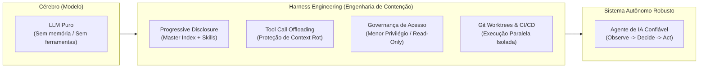
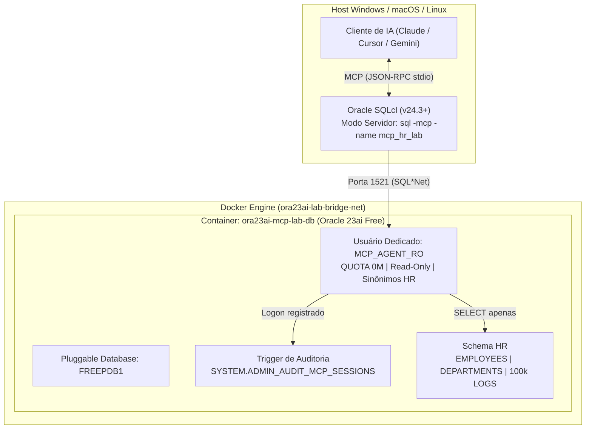
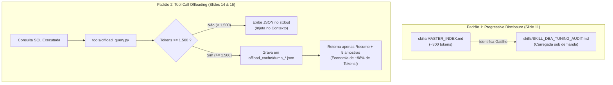
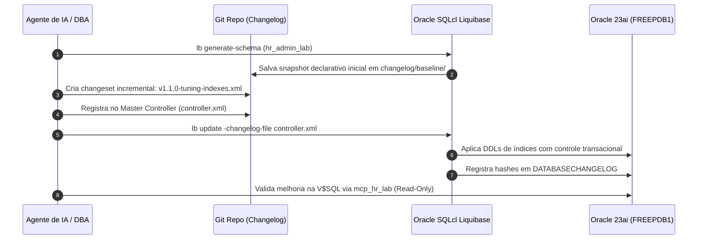

# The APEX Dev Reinvented — Engenharia de Software Moderna & IA Agêntica

Repositório técnico completo consolidando os fundamentos, arquiteturas e implementações práticas da palestra **"The APEX Dev Reinvented"**, apresentada por **Bruno Cardoso** (Oracle ACE Associate & APEX Solutions Architect).

Este projeto documenta a transição de paradigma no ecossistema Oracle: do desenvolvimento visual declarativo tradicional (*click-and-run*, telas manuais e exportações monolíticas) para a **Engenharia de Software Corporativa Moderna**, fundamentada em **Engenharia de Harness** (`MODEL + HARNESS = AGENT`), **Governança com Model Context Protocol (MCP)**, **Schema-as-Code com Liquibase** e **Sistemas Autônomos de IA**.

---

## Documentação de Referência e Recursos

- **Dossiê Analítico Completo:** [docs/AUDITORIA_PALESTRA_APEX.md](docs/AUDITORIA_PALESTRA_APEX.md) (Análise aprofundada dos 40 slides, com transcrição, diagramas Mermaid, prompts práticos e insights de DBA/Arquiteto).
- **Galeria de Slides da Palestra:** [docs/slides/](docs/slides/) (Imagens originais indexadas de 01 a 40 em alta resolução).
- **Configuração MCP para VS Code:** [.vscode/mcp.json](.vscode/mcp.json).

---

## A Tese Central: Engenharia de Harness & Agentes de IA



Modelos de linguagem isolados sofrem de amnésia, operam sem contexto de regras de negócio e tendem a alucinar sob janelas de contexto saturadas (*Context Rot*). O desenvolvedor reintegra seu valor atuando como **Engenheiro de Harness**: projetando restrições determinísticas, ferramentas de baixo nível, governança de credenciais e pipelines de verificação contínua.

---

## Laboratórios Práticos Implementados

O repositório contém três laboratórios práticos e reproduzíveis, cobrindo o ciclo completo de ponta a ponta:

```
oracle-apex-agentic-engineering/
├── lab-01-sqlcl-mcp/            # Infraestrutura Oracle 23ai + Governança SQLcl MCP
├── lab-02-harness-engineering/  # Progressive Disclosure + Tool Call Offloading
└── lab-03-gitops-liquibase/     # Schema-as-Code com Liquibase + Git Worktrees
```

---

### [Laboratório 01: Oracle Database 23ai Free + Oracle SQLcl MCP Server](lab-01-sqlcl-mcp/)

Implementação do ambiente de banco de dados conteinerizado e governança rígida de acesso para agentes de IA via protocolo **Model Context Protocol (MCP)**.



#### Destaques Arquiteturais:
- **Provisionamento Declarativo:** Container Docker `ora23ai-mcp-lab-db` montado em volume persistente `ora23ai-lab-oradata-vol` e rede bridge isolada `ora23ai-lab-bridge-net`.
- **Princípio do Menor Privilégio:** Usuário dedicado `MCP_AGENT_RO` configurado com `QUOTA 0M ON users`, sem privilégios de escrita (`INSERT`/`UPDATE`/`DELETE`/`DROP`), garantindo que agentes nunca alterem dados de produção de forma direta.
- **Transparência com Sinônimos Privados:** Criação automática de sinônimos privados para todas as tabelas do schema `HR`, eliminando a necessidade de expor ou qualificar o schema nas consultas.
- **Auditoria de Sessão:** Trigger `AFTER LOGON` (`TRG_AUDIT_MCP_AGENT_LOGON`) intercepta conexões do agente e registra `OS_USER`, `MODULE`, `MACHINE` e `IP_ADDRESS` em `SYSTEM.ADMIN_AUDIT_MCP_SESSIONS`.
- **Arquivos-Chave:**
  - [lab-01-sqlcl-mcp/docker-compose.yml](lab-01-sqlcl-mcp/docker-compose.yml)
  - [lab-01-sqlcl-mcp/init-scripts/01_setup_hr_and_mcp_governance.sql](lab-01-sqlcl-mcp/init-scripts/01_setup_hr_and_mcp_governance.sql)
  - [lab-01-sqlcl-mcp/init-scripts/02_seed_tuning_scenario.sql](lab-01-sqlcl-mcp/init-scripts/02_seed_tuning_scenario.sql)
  - [lab-01-sqlcl-mcp/README.md](lab-01-sqlcl-mcp/README.md)

---

### [Laboratório 02: Harness Engineering & Mitigação de Context Rot](lab-02-harness-engineering/)

Implementação prática dos dois padrões de contenção e eficiência apresentados nos Slides 11 a 15 da palestra.



#### Destaques Arquiteturais:
- **Progressive Disclosure:** Em vez de poluir a janela de contexto com dezenas de manuais e regras operacionais, o agente inicia lendo apenas o [MASTER_INDEX.md](lab-02-harness-engineering/skills/MASTER_INDEX.md). A skill declarativa [SKILL_DBA_TUNING_AUDIT.md](lab-02-harness-engineering/skills/SKILL_DBA_TUNING_AUDIT.md) só é ativada quando consultas com `/* MCP_TUNING_TARGET */` são detectadas.
- **Tool Call Offloading:** O utilitário CLI [offload_query.py](lab-02-harness-engineering/tools/offload_query.py) conecta em modo thin via `oracledb` e calcula a densidade de tokens ($\lceil \text{len(JSON)} / 4 \rceil$).
- **Validação de Impacto Real:**
  - Consulta volumosa de 500 linhas em `EMPLOYEE_ACTIVITY_LOGS` (~71 KB / ~17.700 tokens) foi interceptada e persistida em disco (`offload_cache/`).
  - O agente recebeu apenas o resumo com status `OFFLOADED_TO_DISK` e amostra inicial (~350 tokens), alcançando **~98% de redução no consumo de contexto**.
- **Arquivos-Chave:**
  - [lab-02-harness-engineering/skills/MASTER_INDEX.md](lab-02-harness-engineering/skills/MASTER_INDEX.md)
  - [lab-02-harness-engineering/skills/SKILL_DBA_TUNING_AUDIT.md](lab-02-harness-engineering/skills/SKILL_DBA_TUNING_AUDIT.md)
  - [lab-02-harness-engineering/tools/offload_query.py](lab-02-harness-engineering/tools/offload_query.py)
  - [lab-02-harness-engineering/README.md](lab-02-harness-engineering/README.md)

---

### [Laboratório 03: GitOps com SQLcl Liquibase & Git Worktrees](lab-03-gitops-liquibase/)

Implementação do ciclo de vida declarativo de banco de dados (*Schema-as-Code*, Slide 27) e estratégias de isolamento de tarefas para múltiplos agentes autônomos (Slide 20).



#### Destaques Arquiteturais:
- **Schema-as-Code Declarativo:** Captura de baseline completa do schema `HR` usando o comando nativo `lb generate-schema`, versionando tabelas, constraints e sequências em XML declarativo.
- **Changesets com Rollback:** Implementação do changeset incremental [v1.1.0-tuning-indexes.xml](lab-03-gitops-liquibase/changelog/changesets/v1.1.0-tuning-indexes.xml) contendo os índices diagnosticados na auditoria e blocos de reversão `<rollback>` explícitos.
- **Segregação de Conexões:**
  - `mcp_hr_lab` (`MCP_AGENT_RO`): Permissões de leitura para diagnósticos sem risco de modificação acidental.
  - `hr_admin_lab` (`HR`): Conexão restrita ao pipeline de CI/CD e comandos Liquibase (`lb update`, `lb rollback`).
- **Validação de Performance Antes vs. Depois:**
  Consultas executadas contra 100.000 registros na tabela `EMPLOYEE_ACTIVITY_LOGS` demonstraram ganhos maciços após a aplicação do changeset:

| Consulta Marcada | Custo CBO (Antes) | Custo CBO (Depois) | Buffer Gets (Antes) | Buffer Gets (Depois) | Redução I/O |
| :--- | :---: | :---: | :---: | :---: | :---: |
| `/* MCP_TUNING_TARGET */ q1_emp_lookup` | **88** | **3** | **317** | **4** | **-98,7%** |
| `/* MCP_TUNING_TARGET */ q2_status_range` | **88** | **3** | **317** | **4** | **-98,7%** |
| `/* MCP_TUNING_TARGET */ q3_emp_severity` | **88** | **3** | **317** | **4** | **-98,7%** |

- **Fluxo Paralelo com Git Worktrees:** Instruções completas demonstrando como criar diretórios de trabalho isolados (`git worktree add ../worktree-agent-tuning feature/tuning-indexes`), permitindo que agentes trabalhem em paralelo sem conflitos de branch e sem necessidade de múltiplos clones pesados.
- **Arquivos-Chave:**
  - [lab-03-gitops-liquibase/changelog/controller.xml](lab-03-gitops-liquibase/changelog/controller.xml)
  - [lab-03-gitops-liquibase/changelog/changesets/v1.1.0-tuning-indexes.xml](lab-03-gitops-liquibase/changelog/changesets/v1.1.0-tuning-indexes.xml)
  - [lab-03-gitops-liquibase/changelog/baseline/controller.xml](lab-03-gitops-liquibase/changelog/baseline/controller.xml)
  - [lab-03-gitops-liquibase/README.md](lab-03-gitops-liquibase/README.md)

---

## Guia de Início Rápido (Quickstart)

### Pré-requisitos
- **Docker Desktop** (com suporte a WSL2 no Windows ou daemon Linux/macOS).
- **Oracle SQLcl 24.3+** com Java 17+ (JDK 21 ou 26 recomendado).
- **Python 3.10+** com `python-dotenv` e `oracledb`.
- **Git** instalado.

---

### 1. Provisionar o Banco de Dados (Lab 01)

```bash
# 1. Copiar variáveis de ambiente do laboratório
cp lab-01-sqlcl-mcp/.env.lab.example lab-01-sqlcl-mcp/.env.lab

# 2. Iniciar o container Oracle 23ai Free
docker compose --env-file lab-01-sqlcl-mcp/.env.lab up -d

# 3. Acompanhar a inicialização até a mensagem "DATABASE IS READY TO USE!"
docker logs -f ora23ai-mcp-lab-db
```

---

### 2. Configurar Conexões Seguras no Oracle SQLcl

```bash
# Conexão Read-Only para o Agente MCP
sql -s /nolog << 'EOF'
conn -save mcp_hr_lab -savepwd mcp_agent_ro/McpReadOnly2026!@localhost:1521/FREEPDB1
exit;
EOF

# Conexão Administrativa para o Liquibase GitOps
sql -s /nolog << 'EOF'
conn -save hr_admin_lab -savepwd hr/HrSchema2026!@localhost:1521/FREEPDB1
exit;
EOF
```

---

### 3. Conectar o SQLcl MCP Server na sua IDE

Adicione a configuração abaixo ao seu cliente MCP (ex: `.vscode/mcp.json` ou Claude Desktop):

```json
{
  "mcpServers": {
    "oracle-sqlcl-hr-lab": {
      "command": "sql",
      "args": [
        "-mcp",
        "-name",
        "mcp_hr_lab"
      ],
      "env": {
        "NLS_LANG": "AMERICAN_AMERICA.AL32UTF8"
      }
    }
  }
}
```

---

### 4. Executar o Tool Call Offloading (Lab 02)

```bash
# Criar e ativar o ambiente virtual Python
python -m venv .venv
.\.venv\Scripts\Activate.ps1   # Windows PowerShell (ou source .venv/bin/activate no Linux/macOS)
pip install oracledb python-dotenv

# Consulta pequena (< 1500 tokens) -> Saída direta no stdout
python lab-02-harness-engineering/tools/offload_query.py "SELECT * FROM departments"

# Consulta volumosa (>= 1500 tokens) -> Offloading automático em disco
python lab-02-harness-engineering/tools/offload_query.py "SELECT * FROM employee_activity_logs FETCH FIRST 500 ROWS ONLY"
```

---

### 5. Aplicar Migrações com SQLcl Liquibase (Lab 03)

```bash
# Navegar até a pasta dos changelogs
cd lab-03-gitops-liquibase/changelog

# Executar a migração declarativa conectando com a credencial administrativa
sql -name hr_admin_lab
SQL> lb update -changelog-file controller.xml
SQL> exit
```

---

## Estrutura Geral do Repositório

```text
oracle-apex-agentic-engineering/
├── .env.example                                      # Modelo de configuração para chaves externas
├── .gitignore                                        # Exclusão estrita de credenciais, logs e caches
├── .vscode/                                          # Configurações do workspace e MCP Server
│   ├── extensions.json
│   ├── mcp.json                                      # Registro do Oracle SQLcl MCP Server
│   └── settings.json
├── docs/                                             # Documentação técnica e recursos
│   ├── AUDITORIA_PALESTRA_APEX.md                   # Dossiê técnico completo dos 40 slides
│   └── slides/                                       # 40 capturas de tela originais da palestra
│       ├── 01-the-apex-dev-reinvented.png
│       └── ...
├── README.md                                         # Este documento consolidado
├── docker-compose.yml                                # Wrapper raiz para inclusão dos labs
├── lab-01-sqlcl-mcp/                                 # Laboratório 01: Banco 23ai + SQLcl MCP
│   ├── .env.lab.example                              # Modelo de credenciais do laboratório
│   ├── docker-compose.yml                            # Compose com nomes determinísticos
│   ├── mcp_config.example.json                       # Configuração de exemplo para clientes MCP
│   ├── README.md                                     # Guia específico do Lab 01
│   └── init-scripts/
│       ├── 01_setup_hr_and_mcp_governance.sql        # Provisionamento de usuários e triggers
│       └── 02_seed_tuning_scenario.sql               # Seed de 100k registros para tuning
├── lab-02-harness-engineering/                       # Laboratório 02: Harness & Context Rot
│   ├── README.md                                     # Guia específico do Lab 02
│   ├── skills/
│   │   ├── MASTER_INDEX.md                           # Catálogo de Progressive Disclosure
│   │   └── SKILL_DBA_TUNING_AUDIT.md                 # Skill declarativa de auditoria DBA
│   └── tools/
│       └── offload_query.py                          # Utilitário de Tool Call Offloading
└── lab-03-gitops-liquibase/                          # Laboratório 03: GitOps & Liquibase
    ├── README.md                                     # Guia específico do Lab 03
    └── changelog/
        ├── controller.xml                            # Master Controller Liquibase
        ├── baseline/                                 # Snapshot declarativo gerado via SQLcl
        │   ├── controller.xml
        │   └── ... (XMLs de tabelas e constraints)
        └── changesets/
            └── v1.1.0-tuning-indexes.xml             # Changeset dos índices com rollback
```

---

## Auditoria de Segurança & Boas Práticas

Antes de qualquer publicação ou compartilhamento deste repositório, foi executada uma auditoria rigorosa de conformidade:

1. **Exclusão de Segredos do Git:**
   - O arquivo [.gitignore](.gitignore) bloqueia explicitamente `.env`, `.env.lab`, `*.wallet`, `cwallet.sso`, `*.key`, `*.pem`, `mcp_config.json`, `.venv/` e todas as pastas `offload_cache/`.
2. **Separação de Papéis no Banco:**
   - Agentes de IA utilizam exclusivamente o usuário `MCP_AGENT_RO` com `QUOTA 0M`, sem privilégios DDL ou DML em tabelas de negócio.
   - Aplicação de esquemas e migrações Liquibase são restritas a pipelines controlados sob o usuário `HR`.
3. **Auditoria de Conexões:**
   - Todas as sessões do agente de IA são rastreadas e persistidas na tabela de auditoria `SYSTEM.ADMIN_AUDIT_MCP_SESSIONS`.

---

## Créditos e Referências

- **Palestra:** *"The APEX Dev Reinvented: Building Autonomous Systems"* — **Bruno Cardoso** | Oracle ACE Associate / Oracle APEX Solutions Architect).
- **Implementação dos Laboratórios, Arquitetura de Banco e Governança:** **Arley Ribeiro** (DBA / Infraestrutura de Dados).
- **Revisão e Estruturação da Escrita:** **IA (Google Gemini)**.
- **Oracle Database 23ai Free:** Oracle Corporation.
- **Oracle SQLcl & Liquibase Integration:** Oracle Database Tools Team.
